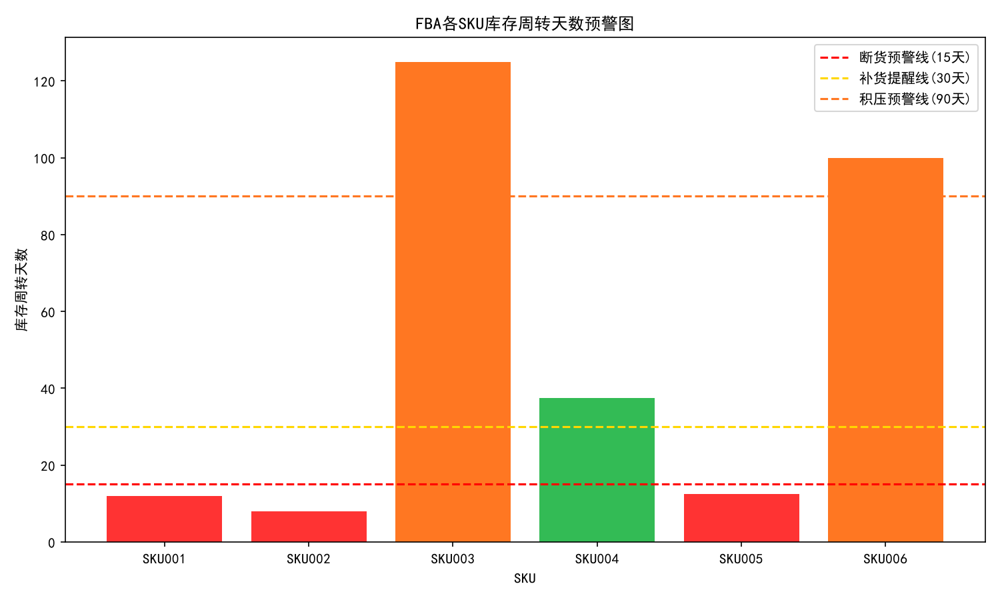

# 亚马逊FBA库存预警分析脚本 | Python(Pandas)
## 项目介绍
模拟亚马逊后台导出FBA库存报表，自动计算库存周转天数，自动识别断货风险、库存积压SKU，输出库存健康预警清单，辅助运营做补货计划、管控仓储成本。

## 业务逻辑
1. 读取FBA库存报表，包含SKU、可售库存、日均销量
2. 计算库存周转天数 = 可售库存 ÷ 日均销量
3. 设置预警阈值：
- ≤15天：紧急断货预警
- 15~30天：库存偏低，需补货
- 30~90天：库存健康
- >90天：库存积压，长期仓储费风险
4. 输出完整报表 + 筛选预警SKU清单，自动导出结果文件

## 技能
Python、Pandas、CSV数据处理、跨境库存运营逻辑

## 使用方法
1. 将FBA后台导出库存csv，替换 sample_inventory.csv
2. 运行 inventory_analysis.py
3. 自动生成 inventory_result.csv 库存分析结果

## 可视化输出
运行脚本后自动生成 `inventory_warn_chart.png`
柱状图展示每个SKU库存周转天数，用不同颜色区分风险等级，同时绘制3条预警参考线，直观查看库存健康状态。

